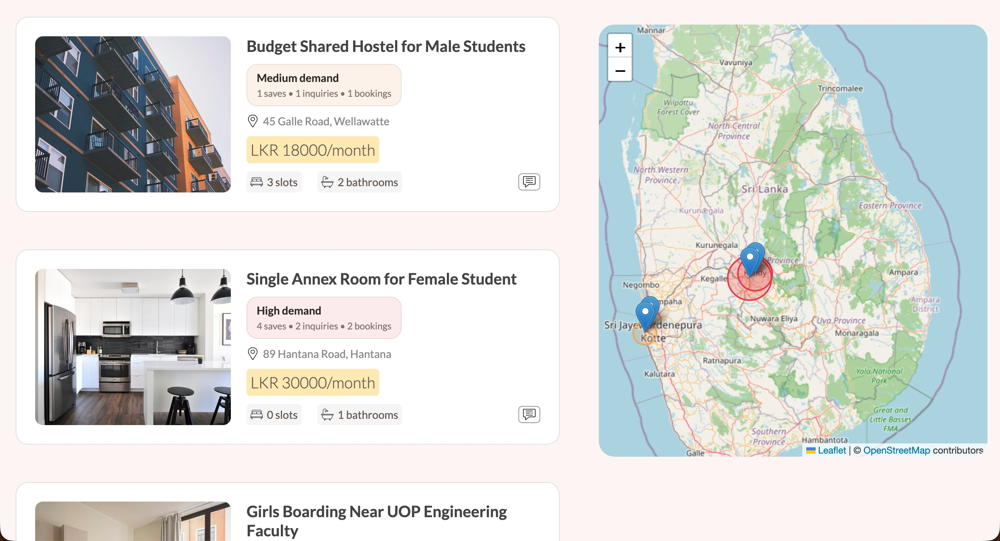
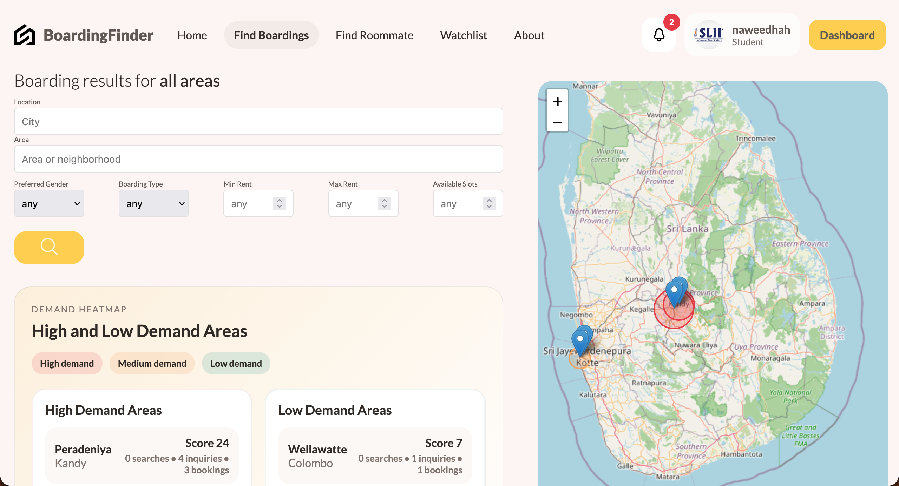
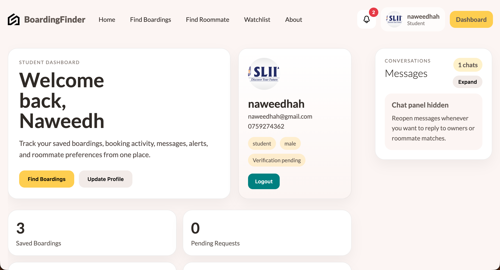
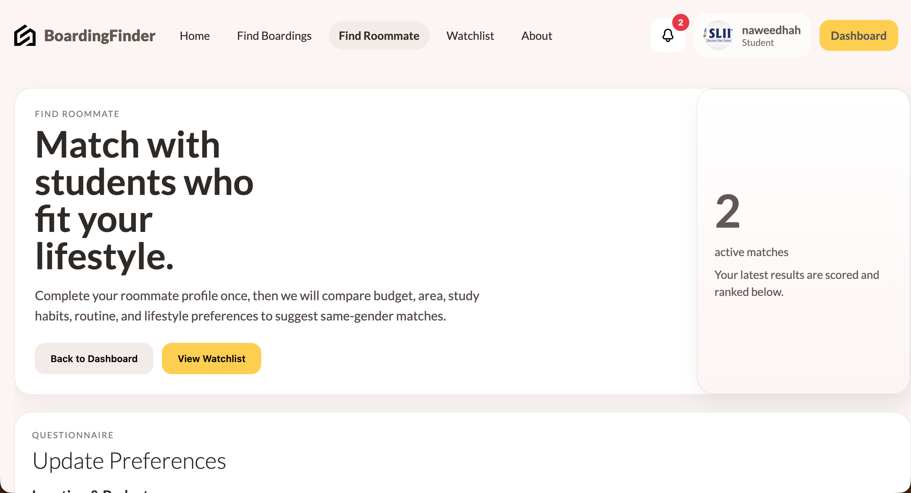
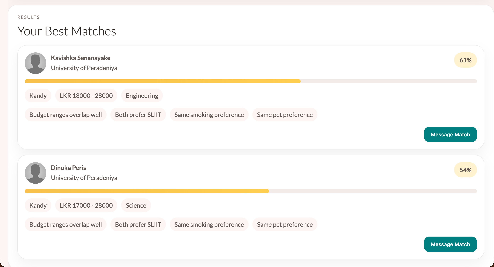

# BoardingFinder

[](https://github.com/naweedhah/boardingfinder-laravel/actions/workflows/ci.yml)

A student boarding (rental room) platform for Sri Lanka: search listings on a map, find rooms
near your campus, chat with owners in real time, request a booking and find a compatible roommate.

**Stack:** Laravel 13 · PHP 8.4 · Sanctum · Laravel Reverb (WebSockets) · Eloquent · PostgreSQL / MySQL / SQLite ·
React 18 + Vite · Leaflet · Zustand · PHPUnit · Playwright · Docker · GitHub Actions

> This repo is my solo Laravel rewrite of a team university project. The original
> Express + Prisma + MongoDB version (built with my team) lives in
> [Smart-Boarding-Finder](https://github.com/naweedhah/Smart-Boarding-Finder). The rewrite keeps
> the same JSON contract, so the React client kept working while the whole backend changed underneath it.



## Features

- **Search** by city/area, price range, room type, tenant gender and free slots
- **Near campus search**: pick a campus (or use your location) and a radius; results are sorted by real distance
- **Interactive Sri Lanka map** of listings and a demand heat map per area
- **Real-time chat and notifications** over WebSockets, with scam screening on messages
- **Booking requests** with live remaining-slot counts and owner approval
- **Saved listings and saved-search alerts** (new listing, price drop, low availability, demand spike)
- **Roommate matching** with a weighted compatibility score and match reasons
- **Reviews, reporting and an admin moderation dashboard** (warn, suspend, review flagged chats)
- **Gemini integration** for owners: draft a listing description, sanity-check room photos

## Engineering highlights

| Problem | What I did |
| --- | --- |
| Two students booking the last slot at the same time | Booking runs in a DB transaction that locks the listing row (`SELECT … FOR UPDATE`), and repeat requests are idempotent ([`BookingService`](backend/app/Services/BookingService.php)) |
| "Rooms within 2 km of SLIIT" must work on SQLite, MySQL and PostgreSQL | An indexed bounding-box `WHERE` narrows rows in SQL, then the exact Haversine distance is computed in PHP ([`Geo`](backend/app/Support/Geo.php), [`PostController@index`](backend/app/Http/Controllers/PostController.php)) |
| Stored XSS through the rich-text description | Server-side allow-list sanitising with HTMLPurifier before saving; the client's DOMPurify is only a second layer ([`HtmlSanitizer`](backend/app/Support/HtmlSanitizer.php)) |
| Bad data from forms (pins in the ocean, swapped lat/lng, `http://` images, absurd rents) | Form Request rules with Sri Lanka coordinate bounds, HTTPS-only image URLs and sane maximums; errors come back per field and show inline in the form |
| Coordinates stored as text (a leftover from MongoDB) | Migration converting them to `DECIMAL(10,7)` with composite indexes for the listing and geo queries; it rolls back cleanly on every engine |
| Authorisation spread across controllers | Sanctum tokens in an httpOnly cookie, role middleware, model Policies, login rate limiting, and tokens revoked on suspension |
| Confidence when refactoring | 155 PHPUnit feature and unit tests, plus Playwright end-to-end specs. CI runs the suite on **SQLite, MySQL 8.4 and PostgreSQL 17**, checks style with Pint, and builds the client and the Docker images |

## Project structure

```
backend/   Laravel 13 API (REST + Reverb WebSockets) - see backend/README.md
client/    React + Vite single-page app (Leaflet maps, Echo for real-time)
docs/      screenshots
docker-compose.yml   PostgreSQL + API + Reverb + client in one command
```

## Run it

### Option A: Docker (one command)

```bash
docker compose up --build
```

| Service | URL |
| --- | --- |
| Web app | http://localhost:5173 |
| API | http://localhost:8800/api |
| WebSockets (Reverb) | ws://localhost:8080 |
| PostgreSQL | localhost:5432 (user and password `boardingfinder`) |

Demo data is seeded on first start. Every demo account uses the password `password123`:
`demo_student`, `demo_owner_kandy`, `demo_owner_colombo`, `demo_admin`.

### Option B: Local

Requirements: PHP 8.3+ (8.4 recommended), Composer, Node.js 20+, and SQLite, MySQL or PostgreSQL.

```bash
# API
cd backend
composer install
cp .env.example .env && php artisan key:generate
touch database/database.sqlite
php artisan migrate --seed
php artisan storage:link
composer dev              # API on :8800 and Reverb on :8080

# Web app (second terminal)
cd client
npm install
npm run dev               # http://localhost:5173
```

### Tests

```bash
cd backend && php artisan test         # 155 PHPUnit tests (in-memory SQLite)
cd client && npx playwright test       # end-to-end specs (needs the API and client running)
```

## Screenshots

| Home | Demand insights |
| --- | --- |
|  |  |

| Watchlist | User dashboard |
| --- | --- |
|  |  |

| Roommate finder | Roommate matches |
| --- | --- |
|  |  |
